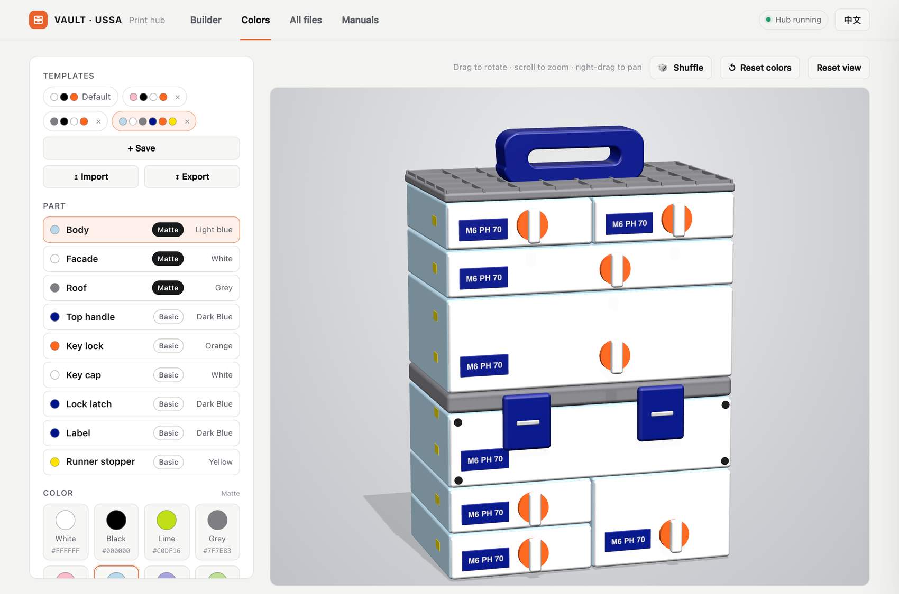

# VAULT Hub 🧰

## ▶ Start here (1 minute)

1. 📁 Copy this repo's files into your **VAULT folder** (the one with `01. DRAWERS`).
2. 🚀 Double-click **`Open VAULT Hub (Mac).command`** or **`(Windows).bat`**.

✅ Done when your browser shows the hub at `http://127.0.0.1:8765`. Keep the terminal window open.

**English** | [简体中文](README.zh-CN.md)

> 🔍 Search, preview and plan prints for the **VAULT** toolbox STL pack, on your own computer.
> ⚠️ Unofficial fan tool. No VAULT files included: use your own copy from Kickstarter / USSA.

## ✨ What you get

| | |
|---|---|
| 📋 **Plan** | Pick drawer or sustainer, size, options → only the files to print, one section per option. |
| 🧊 **See it** | Live 3D preview of your exact unit. ↻ flips to the back. |
| 🎨 **Color it** | 8 Matte + 13 Basic colors on a 3D tower. Save templates. |
| ✅ **Print it** | Tick parts off, gather files into one folder. |
| 🔍 **Browse** | Search 700+ files, orbit any STL, read manuals. English / 中文, phone-friendly. |

## 🔎 Details

### 📋 Plan + 🧊 See it

- At the top: type and quantity, then the size in W × L × H order (width S–XL, length x3–x7, height 1F / 2F / 4F) right above its measurements. On the left: lock, roof, handle, baseplate, dividers, add-ons.
- **Grid dividers (optional):** switch them on (starts with the pieces spanning the width and length), then pick the height (full, mid 34.5 mm on 2F/4F, low 20 mm) and the lengths (↔ fits the width, ↕ fits the depth). Only lengths and heights that fit the drawer are offered.
- **XL 2F / 4F:** official sizes the pack has no body files for. They can be selected so their 82.5 mm dividers, rails, runners and roofs have a unit; module, box and facade show as *not in the pack*.
- **Add-ons:** each chip adds its own section with the parts that fit this size: manual supports (drawers and sustainers), L² version, alternative facade, other baseplate versions, wall mount, pegboards, feet, wheels, handles, backbone, base.
- **One version, never both:** pick a base *whole* or *split*, and backbone / handle-lock parts *sized to the width* or *universal*. The handle lock and knob come with the pull-out handle. On 4F a note says handles need a 1F / 2F backbone elsewhere in the tower.
- **The list mirrors the options:** one section per option, same name and order, showing only the parts you selected. Nothing unneeded is listed.
- **Every STL is reachable from the options** (checked for all 110 type / width / length / height combinations): all 723 appear for at least one choice, and only for sizes they fit.
- A row's switch leaves that part out; it is greyed and skipped by totals and *Gather*.
- **Filament list:** under the controls, one chip per spool to load, e.g. *Lime · Matte × 4*, with the colors you picked on the Colors tab, Hidden mechanism parts with no color slot are grouped as *Any color*. One summed print figure follows (grams, then time).
- The preview shows the outside only (key, label, lid, latches, hinges, roofs) and follows your colors.

### 🎨 Color it + 🏷️ filament tags

- Click a part in 3D or the list, pick a color. 🎲 Shuffle, ↺ Reset, Save / Import / Export.
- Every STL is tagged Matte / Basic / TPU in the Builder and filled with your color. Rules: `material()` in `index.html`.
- Screen colors are approximate: check a real swatch.

### ✅ Print + 🔍 Browse

- Progress is saved in your browser. **Gather into folder** copies files to `_Print Jobs/`.
- File preview: orbit, wireframe, **Open in slicer**, **Show in folder**. Search: press `/`.

### 🛠️ More setup

- **Linux:** `python3 _hub/serve_hub.py`. **Windows without Python:** the launcher falls back to PowerShell.
- **New or renamed files:** `python3 _hub/update_index.py`
- **Thumbnails** (optional, needs Node, Playwright, Chrome): `VAULT_PORT=8799 python3 _hub/serve_hub.py`, then `node _hub/make_thumbs.mjs`, then `python3 _hub/update_index.py`
- The Colors tab and the Builder preview work without STL files.

## 🧯 If it breaks

1. **Python not found** → install Python 3, double-click the launcher again.
2. **File list empty** → run `python3 _hub/update_index.py`, refresh.
3. **3D is blank** → go online (three.js loads from a CDN), refresh.

## 📌 Notes

- Private: listens on `127.0.0.1` only. Nothing is uploaded.
- Code is MIT (see `LICENSE`). VAULT models, manuals and name belong to their owners.
- Issues and PRs welcome.

**Next:** open the hub → **Builder** → pick **M · 4 · 2F**.
