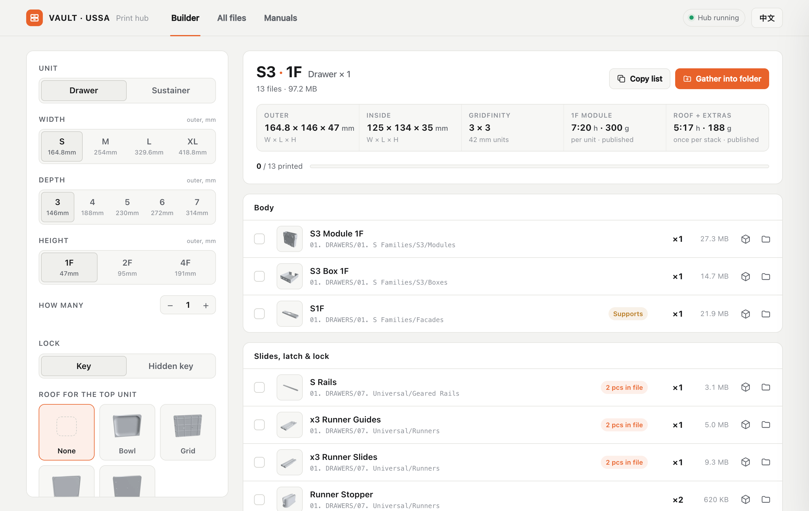

# VAULT Hub

**English** | [简体中文](README.zh-CN.md)

A local, offline-first browser hub for finding your way around the VAULT modular stacking toolbox print files. It turns hundreds of loose STL files and nested folders into a searchable library with 3D previews and a "what do I need to print?" builder.

> **Unofficial fan tool.** Not affiliated with or endorsed by USSA. This repository contains **no** STL, PDF or image files from the VAULT project. You supply your own copy of the files you received as a backer / customer (see [Setup](#setup)).




## The problem

The VAULT file pack has 700+ STL files spread over dozens of nested folders (Drawers, Sustainers, Modifications, each split by size family S / M / L / XL, then by depth, modules, roofs, facades, dividers, baseplates...). Working out which files make up *one* drawer, and printing them without missing a part, takes a lot of clicking.

## Features

- **Builder** – pick type (drawer / sustainer), size, depth and height. The hub lists every part to print with quantities, flags files that already contain a pair, and shows estimated print time and filament weight where published data exists.
- **Print checklist** – tick parts off as they come off the printer. Progress is saved in your browser.
- **Gather into folder** – copy a whole parts list into one `_Print Jobs/<name>` folder, ready to drag into your slicer.
- **Copy list** – export the checklist as plain text.
- **All files** – instant search by file or folder name, filter by Drawers / Sustainers / Modifications / Images & PDFs, with thumbnails.
- **3D preview** – orbit, zoom and inspect any STL in the browser, or drag an STL onto the page.
- **Show in folder / Open in slicer** – jump to the file in Finder / Explorer, or open it with your default app.
- **Manuals tab** – the official PDFs in one place.
- **English / 中文** interface, switchable at any time.

## Setup

1. Download the VAULT files from your own Kickstarter / USSA account and unzip them.
2. Copy the contents of this repository **into the root of that folder**, so it looks like:

   ```
   VAULT/
   ├── 01. DRAWERS/
   ├── 02. SUSTAINERS/
   ├── 03. MODIFICATIONS/
   ├── *.pdf
   ├── index.html                    ← this repo
   ├── Open VAULT Hub (Mac).command  ← this repo
   ├── Open VAULT Hub (Windows).bat  ← this repo
   └── _hub/                         ← this repo
   ```
3. Rebuild the file index once so it matches your copy:

   ```
   python3 _hub/update_index.py
   ```
4. Launch:
   - **macOS** – double-click `Open VAULT Hub (Mac).command` (first time: right-click → Open).
   - **Windows** – double-click `Open VAULT Hub (Windows).bat`. Uses Python if installed, otherwise a built-in PowerShell server.
   - **Linux** – `python3 _hub/serve_hub.py`

The hub opens at `http://127.0.0.1:8765`. Keep the terminal window open while you use it.

> Opening `index.html` directly (double-click) still works for browsing, but browsers block local file access, so 3D preview and "Show in folder" are disabled. Use the launcher.

### Optional: thumbnails

Thumbnails are not included (they are renders of the STL files). To generate them, start the server on port 8799 and run the renderer (needs Node, Playwright and Chrome):

```
VAULT_PORT=8799 python3 _hub/serve_hub.py
node _hub/make_thumbs.mjs
python3 _hub/update_index.py
```

## Requirements

- Python 3 (macOS and Linux) – Windows can fall back to PowerShell
- A modern browser
- Internet access for the 3D preview (three.js is loaded from a CDN)

## Privacy and security

The server binds to `127.0.0.1` only, serves only files inside the project folder, and its write actions (reveal, open, gather) require a custom header that other websites cannot send. Nothing is uploaded anywhere.

## Updating after you add or rename files

```
python3 _hub/update_index.py
```

## Contributing

Issues and pull requests are welcome, especially for new parts rules in the Builder and translations.

## License

Code in this repository: MIT (see `LICENSE`). The VAULT models, manuals and name belong to their respective owners and are **not** covered by this license.
