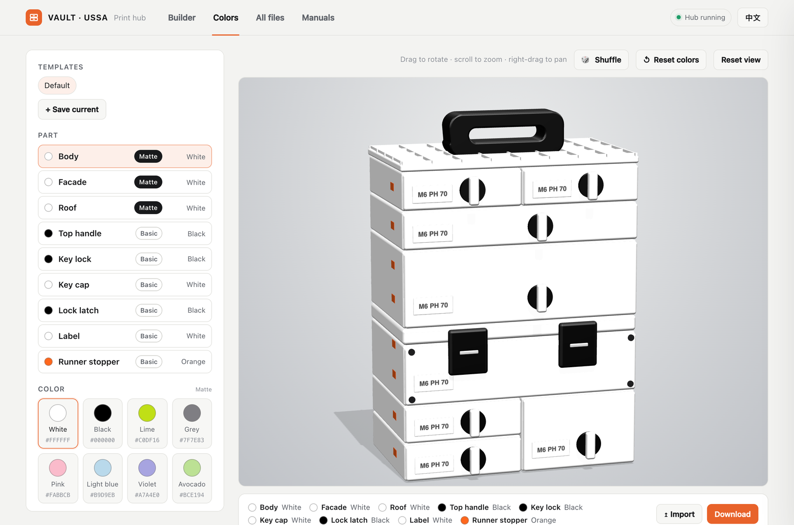

# VAULT Hub

**English** | [简体中文](README.zh-CN.md)

A local browser hub for finding your way around the VAULT modular stacking toolbox print files. It turns hundreds of loose STL files and nested folders into a searchable library with 3D previews, a "what do I need to print?" builder with a live preview of the unit you configured, and a color picker for trying filament colors before you print.

> **Unofficial fan tool.** Not affiliated with or endorsed by USSA. This repository contains **no** STL, PDF or image files from the VAULT project. You supply your own copy of the files you received as a backer / customer (see [Setup](#setup)).

## The problem

The VAULT file pack has 700+ STL files spread over dozens of nested folders (Drawers, Sustainers, Modifications, each split by size family S / M / L / XL, then by depth, modules, roofs, facades, dividers, baseplates...). Working out which files make up *one* drawer, and printing them without missing a part, takes a lot of clicking.

## Highlights

- **Builder** – choose a drawer or sustainer, size and options, and get the complete list of files to print, with quantities, print time and weight estimates and hardware counts.
- **Live preview** – a 3D render of the exact unit you configured (every width, depth, height, quantity, lock, roof and handle), updating as you click.
- **Filament finish tags** – every STL is tagged Matte, Basic or TPU, and each tag is filled with the color you picked for that part.
- **Color picker** – 8 Matte and 13 Basic colors on a 3D tower, click-to-recolor, shuffle, saved color templates, import / export.
- **Print checklist** – tick parts off with a saved progress bar, copy the list, or gather all the files into one folder for your slicer.
- **3D file preview** – orbit any STL in the browser with size and triangle count, wireframe and "open in slicer".
- **Search all files** – instant search and filters over the whole pack, with thumbnails.
- **Manuals** – the official PDFs next to a reference gallery.
- **English / 中文**, light and dark theme that follow your system, and a layout that works on phones.

## Features

### Builder: "what do I need to print?"


Pick a unit and the hub lists every file you need, so nothing gets missed.

- **Live preview** – a 3D render at the top of the options that follows every choice and shows the external parts only: body, facade, key lock and label (drawer) or lid, latches and bolts (sustainer), plus the roof (grid / bowl / heavyweight cover with its bar handle / table / under-table mount) and handle. It uses the colors from the Colors tab. Drag to rotate. The shapes follow the real product: rounded modules, a centered rotary key with a horizontal lever (set low on 2F / 4F boxes), a seam down the middle of tall facades, screw dimples, a small label, pill-shaped runner stoppers on the left wall, sustainer lock latches (a holder plate with a hooked clip over the lid edge; one on S / M, two on L / XL by default) in a recessed pocket with columns of bolts, hinge top plates with four screws, a handle about 126 mm wide, and two feet.
- **Front / back view** – the ↻ button on the preview swings the camera round to the back, where a sustainer's hinges and hinge rods are.
- **Unit type** – Drawer or Sustainer (hinged-lid box).
- **Size** – width S / M / L / XL, depth 3–7, height 1F / 2F / 4F, each with its outer size in mm, plus a quantity.
- **Options** – lock style, roof for the top unit (none / bowl / grid / heavyweight (L and XL) / table / under-table mount), top handle, dividers, Gridfinity baseplate, locks per unit.
- **Spec strip** – outer and inside dimensions, Gridfinity grid size, and estimated print time and filament weight (published figures, where available).
- **Every part is in the list, each with an include switch** – the list shows all the files the unit could use (both key types, top handle, every roof, dividers, Gridfinity baseplates, manual supports, the full lock set, hinges, rods and so on). Parts your options select start switched on, the rest start off; flip any switch to leave a part out or add it. Across all sizes, depths and heights every sustainer file in the pack appears somewhere in the list (including the alternative facades); the drawer files that never appear are the L² / XL² families, which the Builder has no size for, and the loose grid-divider pieces. Parts that are off are greyed and skipped by the file count, tag totals, progress bar, *Copy list* and *Gather*. Your switches are remembered; changing an option (roof, handle, lock, …) resets them to that option's defaults.
- **Parts list** – grouped into Body, Slides / latch / lock, Top of the stack, Optional, Hinges & rods, Lock set and Hardware, with a thumbnail, quantity and file size for each part.
- **Filament finish** – every part is tagged **Matte**, **Basic** or **TPU** (the suggested filament), and the Builder header counts how many of each you need so you can plan filament swaps. The tag is also shown in *All files* and included in *Copy list*, and the tag is filled with the color you picked for that part in the Colors tab (parts without a color role, such as runners, keep the plain tag). Every STL has a recommendation.
- **Smart tags** – "2 pcs in file" marks files that already contain a pair (print once); "Supports" marks files that need support material.
- **Hardware counts** – bolts and other non-printed parts, with quantities.
- **Part names** – the official exploded diagram, one click away.


*Switches on the right: the hidden key, roofs, handle and baseplates are listed but off until you need them.*


*The sustainer view adds hinges & rods, a lock set and a locks-per-unit counter.*


*A sustainer from the front, from the back (hinges and rods) and from the back with custom hinge colors.*

*The preview for six different configurations (from the top left): S3 1F drawer, M4 2F drawer with grid roof and handle, L5 4F drawer with bowl roof and handle, XL3 1F drawer with under-table mount, and M4 2F and XL sustainers.*

| Suggested finish | Parts |
|---|---|
| **Matte** | Modules, boxes, roofs, facades, baseplates, dividers (including Grid Dividers), wheel cover |
| **Basic** | Handles, runners, key and key cap, latch, springs, rails, labels, facade caps; sustainer hinges, rods and lock set; L² accessories; manual supports; backbones, bases, feet, pegboard attachments, wall mounts; wheel bushing, disk and jig |
| **TPU** | Wheel tyre |

The rules live in the `material()` function in `index.html`, so you can adjust them.

### Color picker



Try filament colors on a rendered VAULT tower before you print. The tower is a simplified model built from plain shapes, so it works without any STL files, and it uses the same size and combination as the reference photo (S + S, L 1F, L 2F, sustainer, S 1F over S 1F beside S 2F, with grid roof and handle), seen front-on and turned slightly to the left, so the left side wall (where the runner stoppers are) shows.

- **Matte palette (8):** White, Black, Lime, Grey, Pink, Light blue, Violet, Avocado. **Basic palette (13):** Orange, Red, Yellow, Green, Blue, Dark Blue, White, Beige, Black, Brown, Grey, Blue Grey, Dark Green. A part gets the palette that matches its finish tag.
- **Eleven colorable parts:** Body, Facade, Roof (Matte); Top handle, Key lock, Key cap, Lock latch, Hinge, Hinge rod, Label, Runner stopper (Basic). The hinges are on the back of the sustainer: use the ↻ button in the Builder preview to see them. Pick a part in the list, or click it in the 3D view (hover shows its name), then pick a color.
- **🎲 Shuffle** gives every part a random color.
- **Templates** – *Save* stores the combination as a row of small color circles (one per distinct color, no name needed). Click one to load it, × to delete it (kept in your browser). **Reset colors** puts every part back to its default.
- **Save / Import / Export** – all live in the Templates box. *Export* saves your picks as `colors.json`; *Import* loads such a file (or a template) back in, so picks can be shared or kept with the project. The same file is what the chosen colors will be added to the part labels from later.
- On-screen colors are approximate. Check a physical swatch before printing.


### Print checklist

- Tick parts off as they come off the printer; a progress bar shows how far you are. Progress is saved in your browser, and **Clear checks** resets it.
- **Copy list** exports the checklist as plain text.
- **Gather into folder** copies the whole parts list into one `_Print Jobs/<name>` folder, ready to drag into your slicer.

### 3D preview


- Orbit, zoom and pan any STL in the browser. Shows real size in mm and triangle count (works with 1M+ triangle files).
- Wireframe and reset-view buttons; ← / → steps through the parts, Esc closes.
- **Open in slicer** launches the file in your default app; **Show in folder** jumps to it in Finder / Explorer.
- Drop any STL onto the preview panel to view it, even a file from outside the project.

### All files


- Instant search by file or folder name (press `/` to focus), with category filters: Drawers, Sustainers, Modifications, Images & PDFs.
- Results are grouped by folder, with thumbnails, sizes, the suggested filament finish (Matte / Basic / TPU), and preview and show-in-folder buttons on every row.

### Manuals

- The five official PDFs open inside the hub, next to a gallery of the reference images.

### English / 中文


- Full interface in English and Chinese, switchable with one click. Picks your browser language on first run and remembers your choice.

### Phone and tablet

<p>
  
  &nbsp;&nbsp;
  
</p>

- On narrow screens the preview and the 3D tower come first and the options follow below; vertical swipes still scroll the page.

## Setup

1. Download the VAULT files from your own Kickstarter / USSA account and unzip them.
2. Copy the contents of this repository **into the root of that folder**, so it looks like:

   ```
   VAULT/
   ├── 01. DRAWERS/
   ├── 02. SUSTAINERS/
   ├── 03. MODIFICATIONS/
   ├── *.pdf
   ├── index.html                    ← this repo
   ├── Open VAULT Hub (Mac).command  ← this repo
   ├── Open VAULT Hub (Windows).bat  ← this repo
   └── _hub/                         ← this repo
   ```
3. Rebuild the file index once so it matches your copy:

   ```
   python3 _hub/update_index.py
   ```
4. Launch:
   - **macOS** – double-click `Open VAULT Hub (Mac).command` (first time: right-click → Open).
   - **Windows** – double-click `Open VAULT Hub (Windows).bat`. Uses Python if installed, otherwise a built-in PowerShell server.
   - **Linux** – `python3 _hub/serve_hub.py`

The hub opens at `http://127.0.0.1:8765`. Keep the terminal window open while you use it.

> The Colors tab and the Builder preview are drawn from plain shapes, so they work without the STL files. The file list, thumbnails, 3D file preview and manuals need your copy of the VAULT files.

> Opening `index.html` directly (double-click) still works for browsing, but browsers block local file access, so 3D preview and "Show in folder" are disabled. Use the launcher.

### Optional: thumbnails

Thumbnails are not included (they are renders of the STL files). To generate them, start the server on port 8799 and run the renderer (needs Node, Playwright and Chrome):

```
VAULT_PORT=8799 python3 _hub/serve_hub.py
node _hub/make_thumbs.mjs
python3 _hub/update_index.py
```

## Requirements

- Python 3 (macOS and Linux) – Windows can fall back to PowerShell
- A modern browser
- Internet access for the 3D views: the file preview, the Builder preview and the Colors tab (three.js is loaded from a CDN)

## Privacy and security

The server binds to `127.0.0.1` only, serves only files inside the project folder, and its write actions (reveal, open, gather) require a custom header that other websites cannot send. Nothing is uploaded anywhere.

## Updating after you add or rename files

```
python3 _hub/update_index.py
```

## Contributing

Issues and pull requests are welcome, especially for new parts rules in the Builder and translations.

## License

Code in this repository: MIT (see `LICENSE`). The VAULT models, manuals and name belong to their respective owners and are **not** covered by this license.
