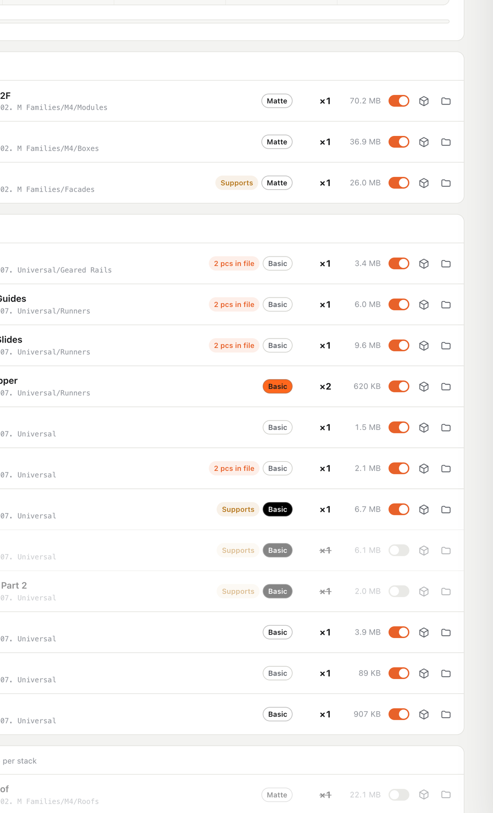
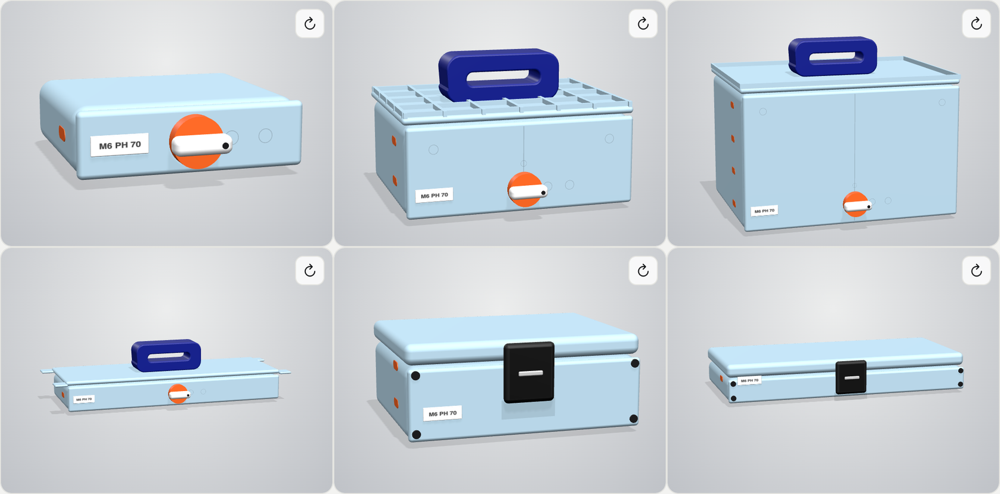
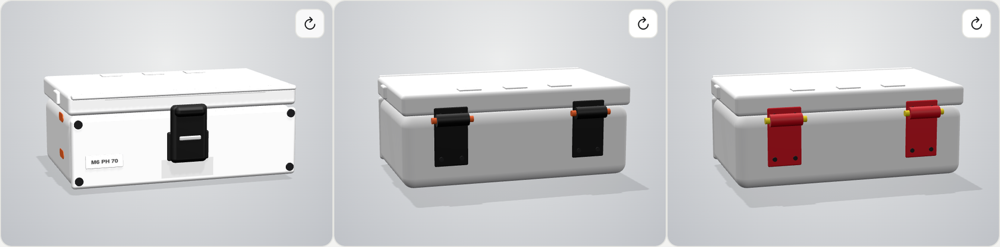
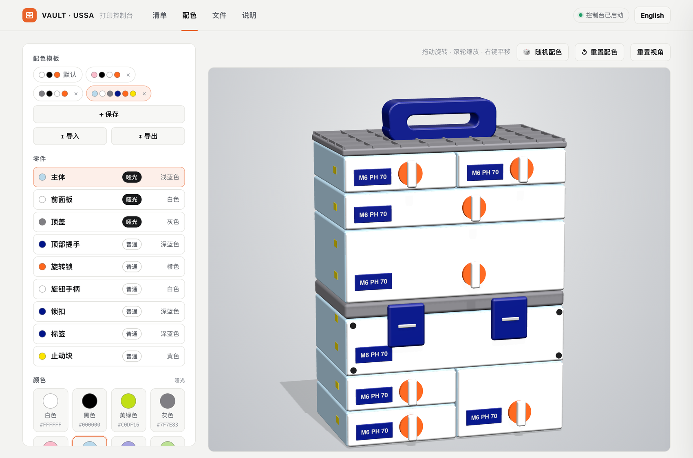
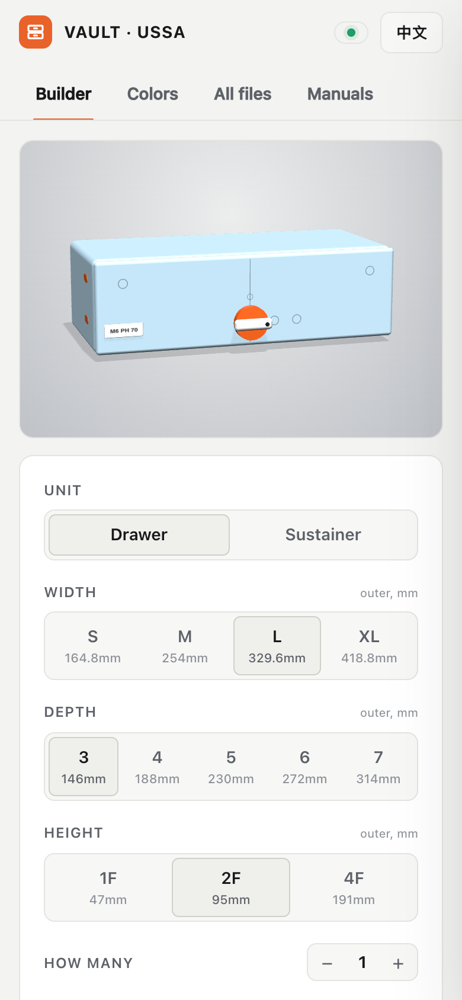
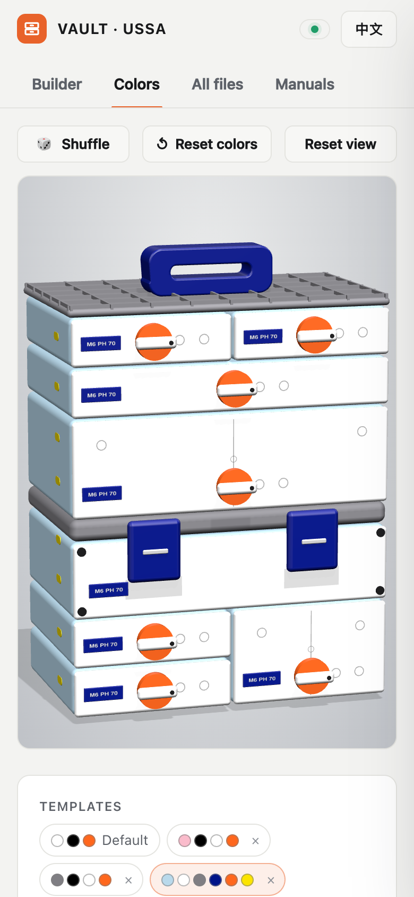

# VAULT Hub 🧰

## ▶ 从这里开始(约 1 分钟)

1. 📁 把本仓库的文件复制到你的 **VAULT 文件夹根目录**(就是有 `01. DRAWERS` 的那个)。
2. 🚀 双击 **`Open VAULT Hub (Mac).command`** 或 **`Open VAULT Hub (Windows).bat`**。

✅ **成功的标志:** 浏览器打开 `http://127.0.0.1:8765` 并显示"清单"页。使用期间请保持终端窗口不要关闭。
(第一次启动会自动为你的文件建索引,几秒钟。)

❓ 还没有 VAULT 文件夹?先从你自己的 Kickstarter / USSA 账号下载文件。本仓库里没有任何 VAULT 文件。


[English](README.md) | **简体中文**

> 🔍 给 **VAULT** 模块化工具箱 STL 文件包(700 多个文件)用的搜索、预览和打印规划工具,在你自己的电脑上运行。
> ⚠️ 非官方的爱好者工具,与 USSA 无关联,也未获其认可。

## ✨ 你能得到什么(5 件事)

| | |
|---|---|
| 📋 **规划打印** | 选抽屉或翻盖收纳盒、尺寸和选项 → 完整的打印文件清单。每个零件可开关。实时 3D 预览。 |
| 🎨 **选颜色** | 在 3D 整机上试 8 种哑光色 + 13 种普通色。随机、保存模板、导入 / 导出。 |
| 🏷️ **知道用什么耗材** | 每个 STL 都标有 哑光 / 普通 / TPU,并填充成你选的颜色。 |
| ✅ **开始打印** | 打完一个勾一个,进度自动保存,复制清单,把文件汇总到一个文件夹。 |
| 🔍 **浏览文件包** | 搜索 700 多个文件,3D 旋转查看任意 STL,读说明书。中文 / English,手机可用。 |

## 🔎 详情(点开一项查看)

<details>
<summary><b>📋 规划打印</b></summary>

- **选择:** 抽屉 / 翻盖收纳盒、宽度 S–XL、深度 3–7、高度 1F / 2F / 4F、数量。
- **选项:** 锁类型、顶盖(无 / Bowl / Grid / Heavyweight(L、XL)/ Table / 桌下安装)、提手、隔板、底板、每个单元的锁数量。
- **规格栏:** 尺寸、Gridfinity 格数、打印时间、耗材重量(有官方数据时)。
- **标签:** "文件含 2 件" = 只打印一次。"需支撑" = 打开支撑。
- **配件数量:** 螺栓等非打印件。


</details>

<details>
<summary><b>🎛️ 每个零件都有开关</b></summary>

- 清单列出这个型号可能用到的**全部**文件:两种钥匙、提手、各种顶盖、隔板、底板、锁组件、铰链。
- 按你的选项选中的零件默认**开着**,其余默认**关着**(变灰)。拨动任意开关即可。
- 关掉的零件不计入文件数、标签统计、进度条、"复制清单"和"汇总到文件夹"。
- 更改选项会把开关恢复为该选项的默认状态。
- 没有列出:L² / XL² 系列(清单没有这些尺寸)和零散的网格隔板件。



</details>

<details>
<summary><b>🧊 实时 3D 预览</b></summary>

- 随尺寸、深度、高度、数量(最多叠 6 个)、锁、顶盖、提手变化。拖动旋转。**↻ 转到背面。**
- 只显示外部,尽量还原实物:圆角模块、居中的旋转锁、标签、止动块、脚垫。
- **翻盖收纳盒:** 平顶盖(斜边、侧耳)、钩形锁扣(S / M 一个,L / XL 两个)、背面带轴的铰链。锁扣和铰链不会高出顶盖。
- **顶盖:** 网格(低矮细筋)、Bowl(浅碟)、Table(细凹槽)、桌下安装(螺丝孔)、重型(厚盖 + 横杆提手)。
- 颜色取自配色页。不需要 STL 文件。





</details>

<details>
<summary><b>🎨 配色</b></summary>

- **色板:** 哑光(白、黑、黄绿、灰、粉、浅蓝、紫罗兰、牛油果绿)。普通(橙、红、黄、绿、蓝、深蓝、白、米、黑、棕、灰、蓝灰、深绿)。
- **11 个零件:** 主体、前面板、顶盖 · 提手、旋转锁、旋钮手柄、锁扣、铰链、铰链轴、标签、止动块。在 3D 里或列表里点选。
- 🎲 **随机配色** · ↺ **重置配色**。
- **模板:** 点"保存"存成一排配色圆点;点圆点载入,点 × 删除。
- **导入 / 导出:** `colors.json`。屏幕上的颜色仅供参考,请对照实物色卡。



</details>

<details>
<summary><b>🏷️ 耗材标签</b></summary>

- 在清单和"文件"里显示,也会带进"复制清单"。填充成你为该零件选的颜色。
- 规则在 `index.html` 的 `material()` 函数里,可直接修改。

| 类型 | 零件 |
|---|---|
| **哑光** | 盒体模块、抽屉箱体、顶盖、前面板、底板、隔板、轮子外盖 |
| **普通** | 提手、滑轨、钥匙与旋钮、卡扣、弹簧、齿条、标签;铰链、轴、锁组件;配件;支撑件;背板、底座、脚垫、挂板、壁挂件;轮子零件 |
| **TPU** | 轮胎 |

</details>

<details>
<summary><b>✅ 打印 · 🔍 浏览 · 🌐 语言 · 📱 手机</b></summary>

- **进度清单:** 打完一个勾一个(保存在浏览器里)、**复制清单**、**汇总到文件夹**(`_Print Jobs/<名称>`)。
- **3D 文件预览:** 旋转 / 缩放 / 平移、线框、← / → 切换零件、**用切片软件打开**、**在文件夹中显示**,也可把任意 STL 拖到面板上。
- **搜索:** 按 `/`。可按 抽屉 / 翻盖收纳盒 / 改装件 / 图片与文档 筛选。**说明:** 5 份官方 PDF 直接在 Hub 内打开。
- **语言:** 一键切换中文 / English。
- **手机:** 预览排在最前面;竖向滑动仍可滚动页面。


<p> &nbsp; </p>

</details>

## 🛠️ 使用细节

<details>
<summary>文件夹结构、其他系统、缩略图</summary>

```
VAULT/
├── 01. DRAWERS/
├── 02. SUSTAINERS/
├── 03. MODIFICATIONS/
├── *.pdf
├── index.html                    ← 来自本仓库
├── Open VAULT Hub (Mac).command  ← 来自本仓库
├── Open VAULT Hub (Windows).bat  ← 来自本仓库
└── _hub/                         ← 来自本仓库
```

- **macOS:** 双击 `.command`(第一次请右键 → 打开)。
- **Windows:** 双击 `.bat`。有 Python 用 Python,否则用自带的 PowerShell 服务。
- **Linux:** `python3 _hub/serve_hub.py`
- **第一次启动:** 启动器会自动建文件索引(仅 Python 启动方式;PowerShell 备用方式需要先运行 `python3 _hub/update_index.py`)。
- **新增或改名文件之后:** `python3 _hub/update_index.py`
- **可选缩略图**(不随仓库提供;需要 Node、Playwright、Chrome):`VAULT_PORT=8799 python3 _hub/serve_hub.py`,然后 `node _hub/make_thumbs.mjs`,再 `python3 _hub/update_index.py`

配色页和清单预览是用简单形状画的,不需要 STL 文件。文件列表、缩略图、3D 文件预览和说明书需要你自己的文件。

</details>

## 🧯 出问题时

1. **终端提示找不到 Python** → 从 python.org 安装 Python 3,然后重新双击启动器。
2. **页面能打开但文件列表是空的** → 文件夹里没有 VAULT 文件,或者你后来新增了文件。运行 `python3 _hub/update_index.py`,再刷新。
3. **3D 画面是空白** → 没有联网。three.js 从 CDN 加载。联网后刷新。
4. **Hub 几秒后就停了** → 终端窗口被关掉了。重新运行启动器,并保持窗口打开。
5. **"在文件夹中显示"没反应** → 你是直接打开 `index.html` 的。请用启动器。

## 📌 须知

- **隐私:** 服务只监听 `127.0.0.1`,只提供项目文件夹内的文件。不会上传任何内容。
- **参与贡献:** 欢迎提 Issue 和 PR,尤其是零件规则和翻译。
- **许可:** 代码采用 MIT(见 `LICENSE`)。VAULT 的模型、说明书和名称归其权利人所有,**不**在此许可范围内。

**下一步:** 打开 Hub,点 **清单**,选 **M · 4 · 2F**,看 3D 预览怎么变。
