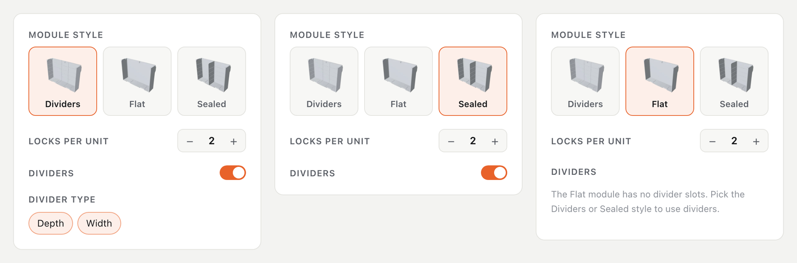

# VAULT Hub 🧰

## ▶ 从这里开始(1 分钟)

1. 📁 把本仓库的文件复制到你的 **VAULT 文件夹**(有 `01. DRAWERS` 的那个)。
2. 🚀 双击 **`Open VAULT Hub (Mac).command`** 或 **`(Windows).bat`**。

✅ 成功的标志:浏览器在 `http://127.0.0.1:8765` 显示 Hub。使用期间请保持终端窗口不要关闭。

[English](README.md) | **简体中文**

> 🔍 给 **VAULT** 工具箱 STL 文件包用的搜索、预览和打印规划工具,在你自己的电脑上运行。
> ⚠️ 非官方爱好者工具。不含任何 VAULT 文件:请用你自己从 Kickstarter / USSA 下载的那份。

## ✨ 你能得到什么

| | |
|---|---|
| 📋 **规划** | 选抽屉或翻盖收纳盒、尺寸、选项 → 要打印的文件。清单只显示选中的零件。 |
| 🧊 **看效果** | 你所配置盒子的实时 3D 预览。↻ 转到背面。 |
| 🎨 **配色** | 在 3D 整机上试 8 种哑光色 + 13 种普通色。可存模板。 |
| ✅ **打印** | 打完一个勾一个,把文件汇总到一个文件夹。 |
| 🔍 **浏览** | 搜索 700 多个文件,旋转查看任意 STL,读说明书。中文 / English,手机可用。 |

## 🔎 详情

### 📋 规划 + 🧊 看效果

- 顶部:类型和数量，然后按 宽 × 长 × 高 的顺序选尺寸(宽度 S–XL、长度 x3–x7、高度 1F / 2F / 4F),下面紧接着显示尺寸数据。左边:锁、顶盖、提手、底板、隔板、附加件。
- **网格隔板(可选):** 打开开关(默认选好横跨宽度和长度的两种隔板),再选高度(满高、2F/4F 的中高 34.5mm、矮款 20mm)和长度(↔ 正好是宽度,↕ 正好是长度)。只提供放得进这个抽屉的长度和高度。
- **翻盖收纳盒的隔板(可选)跟着盒体款式走。** 它们是插进侧壁卡槽的薄板,所以选项取决于款式(已在 STL 上核对):**Dividers** 款 → 深度和宽度隔板;**Sealed** 款 → 密封隔板(一个隔舱宽、满高);**Flat** 款 → 没有卡槽,所以没有隔板(会有提示)。S 和 M 只有一种款式、一种隔板。零件只来自收纳盒文件夹。

- **XL 2F / 4F:** 官方尺寸,但文件包里没有它们的主体文件。可以选择,让 82.5mm 隔板、导轨、滑轨和顶盖有对应的型号;模块、盒子和面板显示为"文件包中没有"。
- **附加件:** 每个标签在右边加一节,里面是适合这个尺寸的零件:手动支撑件(仅抽屉)、L² 版本、备选面板、其他底板版本、壁挂件、挂板、脚垫、轮子、提手、背板、底座。
- **只选一个版本:** 底座选*整体*或*分体*;背板和提手锁选*按宽度*或*通用*。提手锁和旋钮跟拉出式提手一起。4F 会提示:提手需要塔里其他 1F / 2F 盒子的背板。
- **清单和选项一一对应:** 每个选项一节，名称和顺序相同，只显示你选中的零件，不列多余的零件。
- **每个 STL 都能通过选项选到**(已在全部 110 种类型 / 宽度 / 长度 / 高度组合上验证):723 个文件都至少在一种选择下出现，而且只出现在放得下的尺寸里。
- 每行的开关可以去掉这个零件;去掉的会变灰，不计入统计和"汇总到文件夹"。
- **耗材清单:** 控件下面,每种要装的耗材一个标签,例如 *Lime · 哑光 × 4*,颜色来自「配色」页的选择;没有颜色位的内部零件归为「颜色不限」。另有合计的打印数据(先克数,后时间)。
- 预览只显示外部(旋转锁、标签、翻盖、锁扣、铰链、顶盖),颜色取自配色页。

### 🎨 配色 + 🏷️ 耗材标签

- 在 3D 里或列表里点选零件,再选颜色。🎲 随机、↺ 重置、保存 / 导入 / 导出。
- 每个 STL 在清单里都标有 哑光 / 普通 / TPU,并填充成你选的颜色。规则在 `index.html` 的 `material()`。
- 屏幕上的颜色仅供参考,请对照实物色卡。

### ✅ 打印 + 🔍 浏览

- 进度保存在浏览器里。**汇总到文件夹**会把文件复制到 `_Print Jobs/`。
- 文件预览:旋转、线框、**用切片软件打开**、**在文件夹中显示**。搜索:按 `/`。

### 🛠️ 更多设置

- **Linux:** `python3 _hub/serve_hub.py`。**没有 Python 的 Windows:** 启动器会改用 PowerShell。
- **新增或改名文件:** `python3 _hub/update_index.py`
- **缩略图**(可选,需要 Node、Playwright、Chrome):`VAULT_PORT=8799 python3 _hub/serve_hub.py`,然后 `node _hub/make_thumbs.mjs`,再 `python3 _hub/update_index.py`
- 配色页和清单预览不需要 STL 文件。

## 🧯 出问题时

1. **找不到 Python** → 安装 Python 3,重新双击启动器。
2. **文件列表是空的** → 运行 `python3 _hub/update_index.py`,刷新。
3. **3D 画面空白** → 联网(three.js 从 CDN 加载),刷新。

## 📌 说明

- 隐私:只监听 `127.0.0.1`,不上传任何内容。
- 代码采用 MIT(见 `LICENSE`)。VAULT 的模型、说明书和名称归其权利人所有。
- 欢迎提 Issue 和 PR。

**下一步:** 打开 Hub → **清单** → 选 **M · 4 · 2F**。
