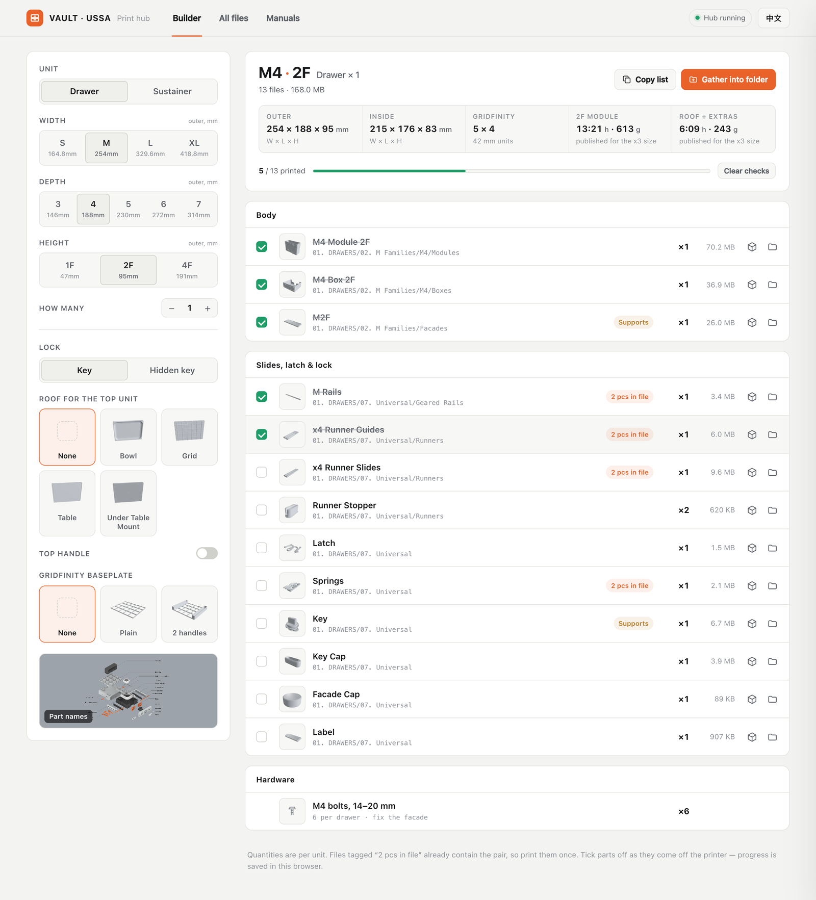
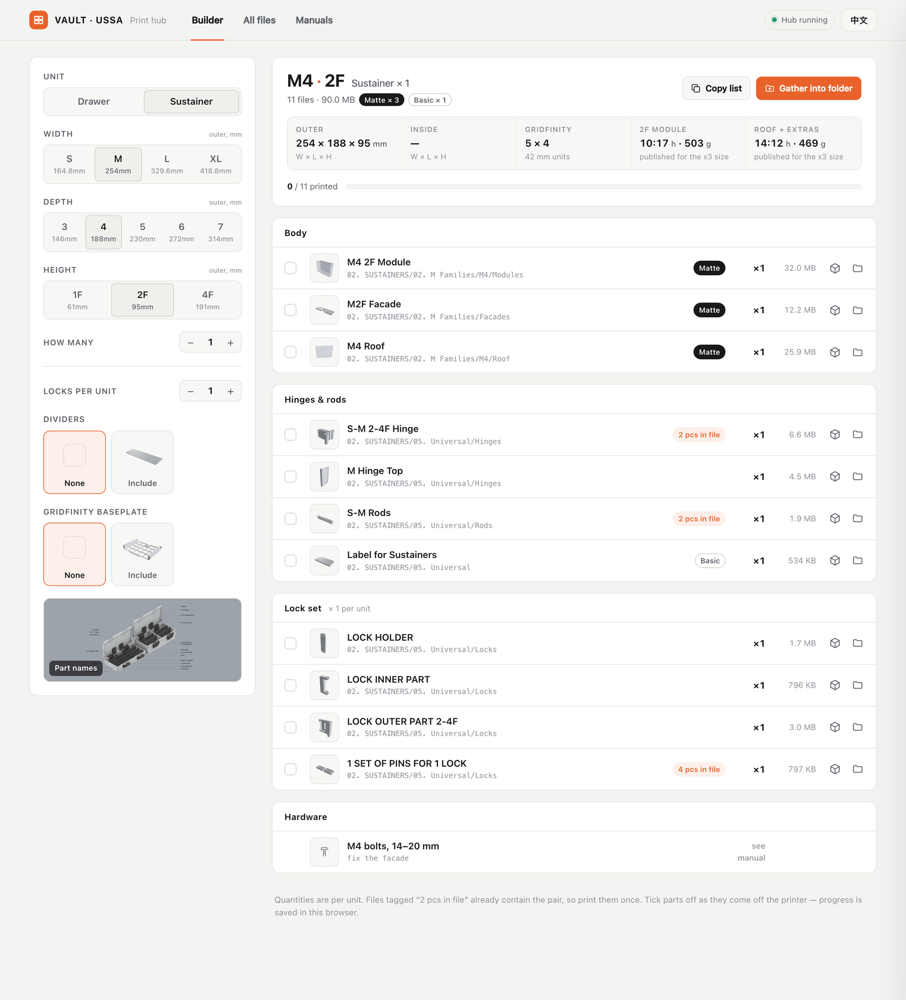
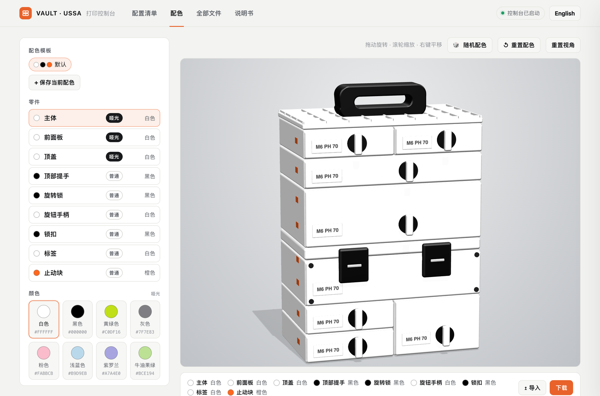
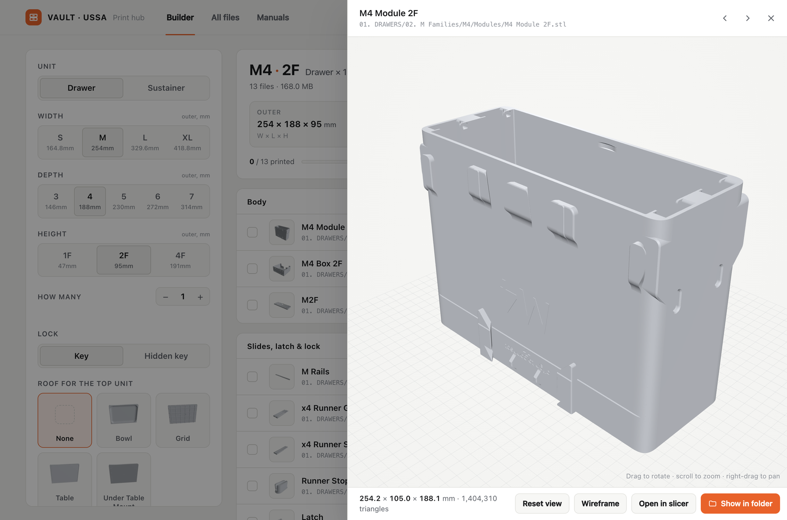
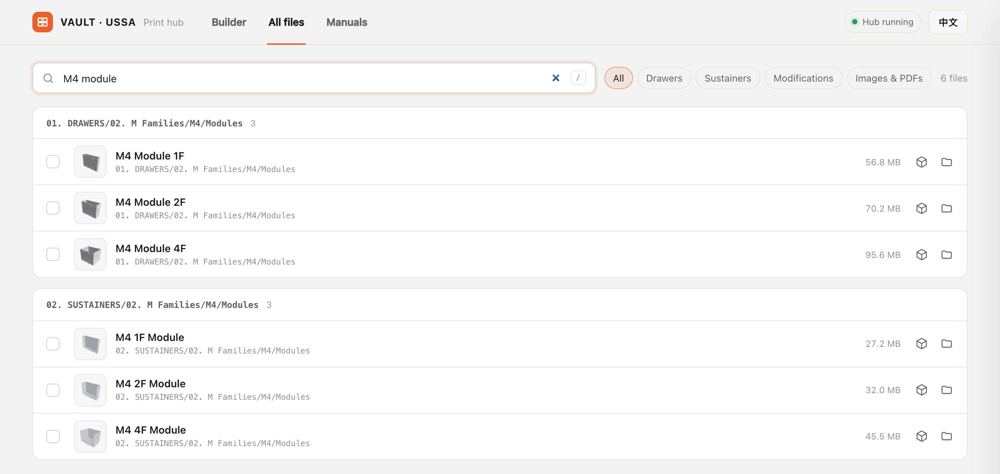
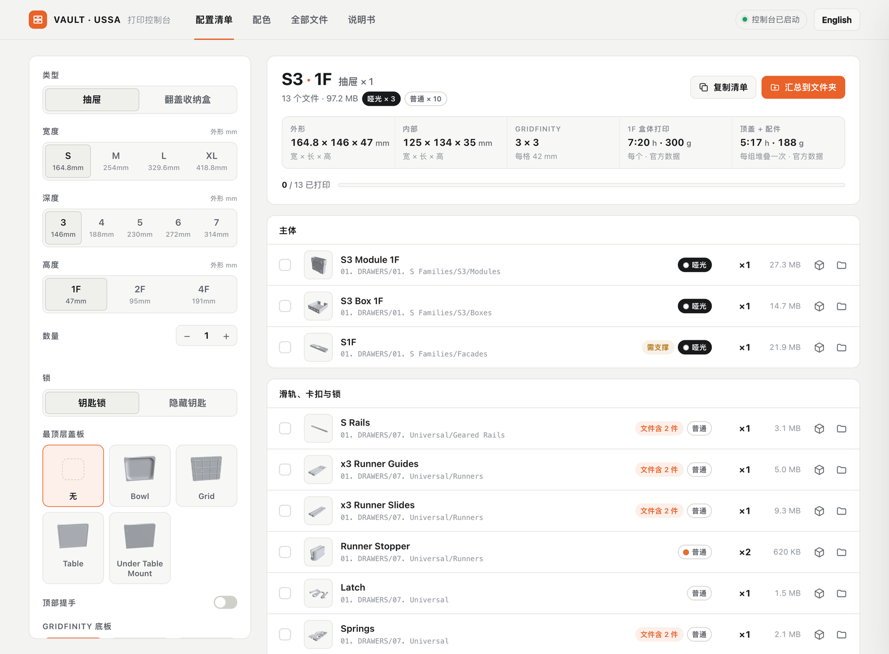

# VAULT Hub

[English](README.md) | **简体中文**

一个在本地浏览器里运行的 VAULT 模块化堆叠工具箱打印文件导航工具。它把几百个零散的 STL 文件和层层嵌套的文件夹，变成可搜索、可 3D 预览、并能告诉你"这个盒子要打印哪些零件"的配置清单。

> **非官方的爱好者工具**，与 USSA 无关联，也未获其认可。本仓库**不包含**任何 VAULT 项目的 STL、PDF 或图片文件，你需要使用自己作为支持者 / 购买者获得的那份文件（见[使用方法](#使用方法)）。

## 解决什么问题

VAULT 的文件包有 700 多个 STL，分散在几十层文件夹里（抽屉、翻盖收纳盒、改装件，每类再按 S / M / L / XL 尺寸系列、深度、盒体、顶盖、面板、隔板、底板……细分）。想搞清楚"一个抽屉到底由哪几个文件组成"，并且打印时不漏件，需要反复点开很多文件夹。

## 功能

### 配置清单:"我要打印哪些文件?"



选好型号,Hub 就会列出需要的全部文件,不会漏件。

- **类型**:抽屉或翻盖收纳盒。
- **尺寸**:宽度 S / M / L / XL,深度 3–7,高度 1F / 2F / 4F,每项都标注外形尺寸(mm),并可设置数量。
- **选项**:锁的类型、最顶层盖板(无 / Bowl / Grid / Table / Under Table Mount)、顶部提手、隔板、Gridfinity 底板、每个单元的锁数量。
- **规格栏**:外形和内部尺寸、Gridfinity 格数,以及预计打印时间和耗材重量(有官方数据时显示)。
- **零件列表**:按 主体、滑轨/卡扣/锁、铰链与轴、锁组件、配件 分组,每个零件都有缩略图、数量和文件大小。
- **耗材类型**:每个零件都标有 **哑光**、**普通** 或 **TPU**(建议使用的耗材),配置清单顶部会统计各有多少个,方便规划换料。"全部文件"里也会显示该标签,"复制清单"时也会带上。所有 STL 文件都有建议。
- **智能标签**:"文件含 2 件"表示该文件已包含一对零件(只需打印一次);"需支撑"表示需要添加支撑。
- **配件数量**:螺栓等非打印件及其数量。
- **零件命名图**:官方爆炸图,一键查看。



*翻盖收纳盒视图会额外显示铰链与轴、锁组件和每个单元的锁数量。*

| 建议类型 | 零件 |
|---|---|
| **哑光** | 盒体模块、抽屉箱体、顶盖、前面板、底板、隔板(含 Grid Dividers)、轮子外盖 |
| **普通** | 提手、滑轨、钥匙与旋钮、卡扣、弹簧、齿条、标签、面板盖;翻盖收纳盒的铰链、轴和锁组件;L² 配件;手动支撑件;背板(Backbone)、底座(Base)、脚垫、挂板转接件、壁挂件;轮子的衬套、轮盘和治具 |
| **TPU** | 轮胎 |

规则写在 `index.html` 的 `material()` 函数中,可按需修改。

### 配色



打印前先在渲染出的 VAULT 整机上试颜色。整机是用简单形状搭出来的简化模型,不需要 STL 文件也能使用;尺寸和组合与参考图一致(S + S、L 1F、L 2F、翻盖收纳盒、S 1F 叠 S 1F 旁边加 S 2F,顶部是网格顶盖和提手),正面略微偏向左侧的视角,可以看到左侧壁(止动块所在的位置)。

- **哑光色板(8 色):** 白色、黑色、黄绿色、灰色、粉色、浅蓝色、紫罗兰、牛油果绿。**普通色板(13 色):** 橙色、红色、黄色、绿色、蓝色、深蓝色、白色、米色、黑色、棕色、灰色、蓝灰色、深绿色。每个零件使用与其耗材标签对应的色板。
- **9 个可配色零件:** 主体、前面板、顶盖(哑光);顶部提手、旋转锁、旋钮手柄、锁扣、标签、止动块(普通)。在列表中选零件,或直接在 3D 画面里点它(悬停会显示名称),再选颜色。
- **🎲 随机配色** 给每个零件随机一种颜色。
- **配色模板**:点"保存当前配色"就会把这组配色存成一排小圆点(每种颜色一个,不需要起名字);点圆点即可载入,点 × 删除(保存在浏览器里)。**重置配色** 会把所有零件恢复为默认颜色。
- **导入 / 下载**:下载会把你的选择保存为 `colors.json`;导入可以把这样的文件(或模板)重新载入,方便分享或随项目保存。之后也会用这个文件把选定的颜色加到零件标签里。
- 屏幕上的颜色仅供参考,打印前请对照实物色卡确认。

### 打印进度清单

- 零件打印完一个勾一个,进度条实时显示完成情况。进度保存在浏览器中,点击**清除勾选**可重置。
- **复制清单**可将清单导出为纯文本。
- **汇总到文件夹**会把整份零件清单复制到 `_Print Jobs/<名称>` 文件夹,方便直接拖进切片软件。

### 3D 预览



- 在浏览器中旋转、缩放、平移任意 STL,显示实际尺寸(mm)和三角面数(百万面级的文件也能打开)。
- 提供线框模式和重置视角按钮;← / → 切换上一个/下一个零件,Esc 关闭。
- **用切片软件打开**会用默认程序打开文件;**在文件夹中显示**会在 Finder / 资源管理器中定位。
- 把任意 STL 拖到预览面板上即可查看,不限于项目文件夹内的文件。

### 全部文件



- 按文件名或文件夹名即时搜索(按 `/` 聚焦搜索框),并可按 抽屉 / 翻盖收纳盒 / 改装件 / 图片与文档 筛选。
- 结果按文件夹分组,每一行都有缩略图、文件大小、建议耗材(哑光 / 普通 / TPU),以及预览和"在文件夹中显示"按钮。

### 说明书

- 五份官方 PDF 直接在 Hub 内打开,旁边附带参考图库。

### 中文 / English



- 完整的中英文界面,一键切换。首次打开时会根据浏览器语言自动选择,并记住你的选择。

## 使用方法

1. 从你自己的 Kickstarter / USSA 账号下载 VAULT 文件并解压。
2. 把本仓库的内容复制到解压后文件夹的**根目录**，结构如下：

   ```
   VAULT/
   ├── 01. DRAWERS/
   ├── 02. SUSTAINERS/
   ├── 03. MODIFICATIONS/
   ├── *.pdf
   ├── index.html                    ← 来自本仓库
   ├── Open VAULT Hub (Mac).command  ← 来自本仓库
   ├── Open VAULT Hub (Windows).bat  ← 来自本仓库
   └── _hub/                         ← 来自本仓库
   ```
3. 运行一次索引脚本，让文件列表与你本地的文件一致：

   ```
   python3 _hub/update_index.py
   ```
4. 启动：
   - **macOS**：双击 `Open VAULT Hub (Mac).command`（第一次请右键 → 打开）。
   - **Windows**：双击 `Open VAULT Hub (Windows).bat`。已安装 Python 时使用 Python，否则自动改用系统自带的 PowerShell 服务。
   - **Linux**：`python3 _hub/serve_hub.py`

Hub 会在 `http://127.0.0.1:8765` 打开。使用期间请保持终端窗口不要关闭。

> 直接双击 `index.html` 也能浏览，但浏览器会禁止读取本地文件，因此 3D 预览和"在文件夹中显示"不可用。请使用启动器。

### 可选：生成缩略图

缩略图由 STL 渲染而来，因此不随仓库提供。如需生成，先在 8799 端口启动服务，再运行渲染脚本（需要 Node、Playwright 和 Chrome）：

```
VAULT_PORT=8799 python3 _hub/serve_hub.py
node _hub/make_thumbs.mjs
python3 _hub/update_index.py
```

## 运行要求

- Python 3（macOS / Linux）；Windows 没有 Python 时可使用 PowerShell
- 较新的浏览器
- 3D 预览需要联网（three.js 从 CDN 加载）

## 隐私与安全

服务只监听 `127.0.0.1`，只提供项目文件夹内的文件；会执行操作的接口（定位、打开、汇总）需要自定义请求头，其他网站无法发起。不会上传任何内容。

## 新增或改名文件之后

```
python3 _hub/update_index.py
```

## 参与贡献

欢迎提交 Issue 和 Pull Request，尤其是 Builder 的零件规则补充和翻译。

## 许可

本仓库代码采用 MIT 许可（见 `LICENSE`）。VAULT 的模型、说明书和名称归其各自权利人所有，**不**在此许可范围内。
